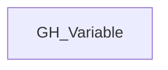

# GH_Variable

## General Information

Generic label applied to GitHub variable nodes across organization, repository, and environment scope.

## Diagram

## References

- [Actions variables API](https://docs.github.com/en/rest/actions/variables)
