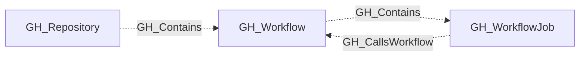

# GH_Workflow

## General Information

Represents a GitHub Actions workflow defined in a repository. Workflow nodes capture the workflow definition metadata including its file path, state, containing repository, and the full YAML contents of the workflow file. Only repositories with GitHub Actions enabled are queried for workflows.

When present, `workflow_permissions` captures the top-level `permissions` declaration from the workflow YAML.

## Diagram

## References

- [Secure use of GitHub Actions](https://docs.github.com/en/actions/reference/security/secure-use)
