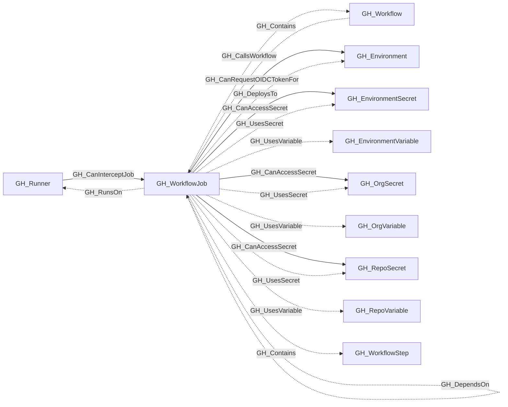

# GH_WorkflowJob

## General Information

Represents a single job within a GitHub Actions workflow. Jobs are the top-level execution units of a workflow — they run on a runner, hold a set of steps, and can declare permissions, environments, and dependencies on other jobs.

When the job has a statically resolvable self-hosted `runs-on` selector, GH_RunsOn edges identify each GH_Runner that currently satisfies the declared label and runner-group constraints under the repository's runner access policy. These edges represent schedulability, not historical execution.

When present, `job_permissions` captures the job-level `permissions` declaration from the workflow YAML. `effective_github_token_permissions` captures the calculated static `GITHUB_TOKEN` permissions after applying the repository default, workflow-level declaration, and job-level declaration.

GH_CanAccessSecret edges identify secrets statically referenced by the job's modeled steps or job-level `env` block that the job execution context can access. GH_CanInterceptJob edges from GH_Runner nodes not explicitly marked ephemeral identify jobs whose future execution context may be exposed if that runner is controlled. When a job targets an environment and its effective permissions include `id-token:write`, GH_CanRequestOIDCTokenFor identifies a static upper-bound OIDC capability for that environment. Runtime permission recalculation, such as forked `pull_request` permission downgrades, may prevent a specific execution from requesting OIDC even when this edge exists.

When `runs_on_is_dynamic` is true, runner matching and interception status remain unresolved: the collector does not emit GH_CanInterceptJob edges for the job, so `query_interceptable_jobs` cannot match it and the absence of an edge must not be treated as evidence that the job is definitively non-interceptable.

## Diagram

## References

- [Workflow jobs API](https://docs.github.com/en/rest/actions/workflow-jobs)
