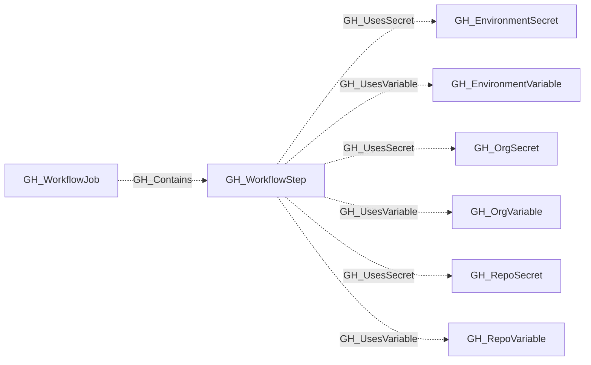

# GH_WorkflowStep

## General Information

Represents a single step within a GitHub Actions job. A step is either a `uses:` action reference or a `run:` shell command. Steps are the leaf nodes of the workflow execution tree and are the primary location where secrets and variables are consumed.

## Diagram

## References

- [Secure use of GitHub Actions](https://docs.github.com/en/actions/reference/security/secure-use)
